     
 
🌫️ Hashira Profile
<table> <tr><td><b>Name</b></td><td>Anikha Padala</td></tr> <tr><td><b>College</b></td><td>KLH · B.Tech CSE · 2nd Year</td></tr> <tr><td><b>Breathing (main stack)</b></td><td>Python · Java · React</td></tr> <tr><td><b>Interests</b></td><td>Startups &amp; product building · AI &amp; search algorithms · IoT · Full-stack web</td></tr> <tr><td><b>Currently training</b></td><td>DSA · Node.js · Full-stack development</td></tr> <tr><td><b>Goal</b></td><td>Build my own full-stack product / startup</td></tr> </table> 
⚔️ Tech Arsenal · Breathing Forms
<table> <tr> <td><b>Languages</b></td> <td>     </td> </tr> <tr> <td><b>Frontend</b></td> <td>     </td> </tr> <tr> <td><b>Backend</b></td> <td>   </td> </tr> <tr> <td><b>Tools &amp; Embedded</b></td> <td>     </td> </tr> </table> 
🗡️ Featured Techniques
<table> <tr> <td width="50%" valign="top"> <h4>🏦 BankerGuard</h4> Banker's Algorithm deadlock-avoidance dashboard        <!-- TODO: replace with the exact repo URL --> <a href="https://github.com/hashiratokito?tab=repositories"><b>View project →</b></a> </td> <td width="50%" valign="top"> <h4>🧭 Campus Navigation System</h4> Shortest-path campus routing using A* search       <!-- TODO: replace with the exact repo URL --> <a href="https://github.com/hashiratokito?tab=repositories"><b>View project →</b></a> </td> </tr> <tr> <td width="50%" valign="top"> <h4>🩺 Home Healthcare Visit Scheduler</h4> Plan and track home visits, saved in the browser       <!-- TODO: replace with the exact repo URL --> <a href="https://github.com/hashiratokito?tab=repositories"><b>View project →</b></a> </td> <td width="50%" valign="top"> <h4>💧 Water Quality Monitor</h4> Real-time IoT monitoring and alerts for water quality       <!-- TODO: replace with the exact repo URL --> <a href="https://github.com/hashiratokito?tab=repositories"><b>View project →</b></a> </td> </tr> </table>

Also in the vault: <a href="https://github.com/hashiratokito/2520030613-DBMS_Project">DBMS</a> · <a href="https://github.com/hashiratokito/2520030613-DSA-Project">DSA</a> · <a href="https://github.com/hashiratokito/2520030613-ML">ML</a>

📊 Telemetry

     
 
🎮 Mist Hashira Game
 
🌱 Currently Training
🧩 Sharpening DSA and learning Node.js
🏗️ Building my own full-stack product from scratch
📝 Giving every project a professional README

 
<b>🗒️ Open the training log</b>
  
Skill	Status
Python · Java · React · SQL	In use
Data structures & algorithms	Training
Node.js	Learning
Full-stack project	Building

 
📡 Connect

  

  

 
<b>🌫️ Click to clear the mist</b>
   <code>Seventh Form: Obscuring Clouds, unlocked.</code>  Open to ideas, collaborations and startup chats. Fork a project, open an issue, or just say hi. 
     

