


| Attribute | Details |
|-----------|---------|
| 🌫️ Name | **Anikha Padala** |
| 🎓 Education | B.Tech Computer Science Engineering · KLH |
| ⚔️ Current Level | Software Engineering Student |
| 🚀 Mission | Build Real-World Software Products |
| 🌐 Focus Areas | Full Stack • AI • Cloud • DSA |
| ☁️ Learning | AWS • ML • System Design |
| 🌫️ Inspiration | Mist Hashira - Muichiro Tokito |

> *"Like the mist, true mastery appears simple from a distance."*

### Languages

### Frontend

### Backend

### Databases

### Cloud & Tools


<table width="100%">
<tr>
<td width="33%"><a href="https://github.com/HashiraTokito/BankerGuard-OS"></a></td>
<td width="33%"><a href="https://github.com/HashiraTokito/CampusNavigationSystem"></a></td>
<td width="33%"><a href="https://github.com/HashiraTokito/2520030613-2ndOddSemMLProject"></a></td>
</tr>
<tr>
<td width="33%"><a href="https://github.com/HashiraTokito/2520030613-2ndOddSemDBMSProject"></a></td>
<td width="33%"><a href="https://github.com/HashiraTokito/2520030613-2ndOddSemDSAProject"></a></td>
<td width="33%"><a href="https://github.com/HashiraTokito/2520030613-1stOddSemJavaProject"></a></td>
</tr>
</table>

Click any card to open the repository.


<b>🗝️ Open the full vault list</b>

 

**Programming:** Java Basics · Python Essentials I · Python Essentials II · JavaScript Essentials · HTML Essentials · CSS Essentials · Introduction To SQL · MongoDB

**AI & Data:** Introduction To Modern AI · Data Analytics Essentials · Data Science With Python · Apply AI - Analyze Customer Reviews

**Systems & Security:** Linux Essentials · Linux I · Linux II · Operating Systems Basics · Network Defense · Endpoint Security · Cyber Threat Management · Introduction To Cybersecurity

**Problem Solving:** 500 Problems On CodeChef · LeetCode 50 Days Challenge

<!-- CERTIFICATE GALLERY: certificate images will be added here once chosen -->



<table width="100%">
<tr><td>✅ Strengthen DSA</td><td>✅ Learn AWS Cloud</td></tr>
<tr><td>✅ Build Full Stack Projects</td><td>✅ Explore Machine Learning</td></tr>
<tr><td>✅ Improve System Design</td><td>✅ Contribute to Open Source</td></tr>
<tr><td colspan="2">✅ Become Industry Ready</td></tr>
</table>


  

